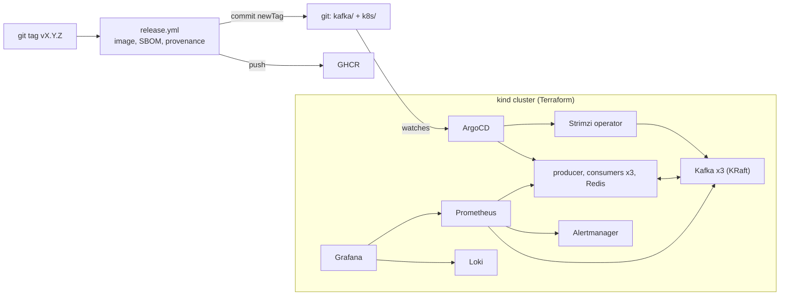

# Kafka SRE Platform

Running **Kafka on Kubernetes** the way an SRE team would: as code, with
SLOs, alerts that link to runbooks, chaos drills that prove the alerts
work, and GitOps so every change is a pull request.

The workload is a small hotel-price pipeline: a producer publishes price
updates to Kafka, a consumer group writes the latest price per hotel to
Redis. **The platform around it is the point**: a 3-node KRaft cluster run
by the Strimzi operator, consumer-lag and freshness SLOs, 15 alerts with 15
runbooks, policy-as-code for Kafka durability, and the same design on
Google Cloud (GKE, Compute Engine, Memorystore) in Terraform.

| | Local track | GCP track |
|---|---|---|
| Runs on | kind on your laptop, free | GKE (private), Compute Engine, Memorystore |
| Provisioned by | Terraform (`infra/local-kind`) | Terraform (`infra/gcp`) |
| Kafka | Strimzi, 3 KRaft nodes | same manifests (`kafka/`) |
| Deployed by | ArgoCD (GitOps) | ArgoCD; infra by GitHub Actions + Workload Identity Federation |
| Observed with | Prometheus, Alertmanager, Grafana, Loki | same, plus Cloud Monitoring for disks, Redis, restarts |
| Status | runs end to end | code: validated, planned and policy-checked in CI, not yet applied |
| Start with | `make up` | `make plan-offline` (no account needed) |

---

## How it works

```
 price-producer (1 pod)                                 acks=all, idempotent
        |  key = hotel_id  (same hotel -> same partition -> in order)
        v
 Kafka topic "price-updates"    6 partitions x 3 replicas, min.insync.replicas=2
 (3 KRaft nodes, Strimzi)       one node can fail with no data loss and no failed writes
        |
        v
 consumer group "price-indexer" (3 pods, 2 partitions each)
        |
        +-- valid event ------------> Redis  HSET price:<hotel> <partner> <price>
        |                             (idempotent: a replay writes the same value)
        +-- bad event --------------> "price-updates.dlq" (with reason + source offset)
        |                             one poison message never blocks a partition
        +-- Redis down -------------> rewind to that offset, retry with backoff
                                      nothing skipped: lag grows, then drains
        |
        v
 offset stored only after the event is handled  ->  at-least-once delivery
```

```
 Prometheus  <-- JMX metrics from the 3 Kafka nodes (ISR, controller, throughput)
             <-- Kafka Exporter (consumer lag per partition)
             <-- /metrics of producer + consumer (end-to-end latency, DLQ, errors)
      |
      +--> recording rules (SLIs) --> 15 alerts --> Alertmanager (routing, inhibition)
      |                                    |
      |                                    +--> runbook_url -> runbooks/<Alert>.md
      +--> Grafana "Kafka SRE - Price Pipeline"  (+ Loki logs panel)
```



---

## Run it locally

### Prerequisites (WSL2 / Ubuntu)

Docker Desktop with WSL integration, then `kubectl`, `kind` and `helm`:

```bash
curl -LO "https://dl.k8s.io/release/$(curl -Ls https://dl.k8s.io/release/stable.txt)/bin/linux/amd64/kubectl"
sudo install kubectl /usr/local/bin/ && rm kubectl
curl -Lo kind https://kind.sigs.k8s.io/dl/v0.24.0/kind-linux-amd64 && sudo install kind /usr/local/bin/ && rm kind
curl -fsSL https://raw.githubusercontent.com/helm/helm/main/scripts/get-helm-3 | bash
```

**Memory:** the full stack needs about 7 GB. On Windows, give WSL 8 GB in
`%USERPROFILE%\.wslconfig` (`[wsl2]` / `memory=8GB`). `SKIP_LOKI=1 make up`
saves ~300 MB. Only one kind cluster should run at a time; setup stops with
a clear message if another one is running.

Terraform is optional (setup falls back to `kind create cluster`).

### Start

```bash
make up            # ~10 minutes the first time (images, Kafka start-up)
```

`scripts/setup.sh` is idempotent: run it again after a reboot to restart
the port-forwards. In order it does:

```
cluster -> build image, load into kind -> Prometheus/Alertmanager/Grafana -> Loki
   -> Strimzi operator -> Kafka (waits for Ready) -> topics -> apps -> ArgoCD
   -> port-forwards -> verify (prints the consumer group)
```

Every `kubectl`/`helm` call is pinned to the `kind-kafka-sre` context.

| Service | URL | Login |
|---|---|---|
| Grafana | http://localhost:3030 → *Kafka SRE - Price Pipeline* | admin / admin |
| Prometheus | http://localhost:9090/alerts | |
| Alertmanager | http://localhost:9093 | |
| ArgoCD | https://localhost:8443 | admin / printed by setup |

Pause without losing anything: `docker stop kafka-sre-control-plane kafka-sre-worker`
(`docker start` + `make up` to resume). Delete everything: `make down`.

### Everyday operations

| Command | Shows |
|---|---|
| `make status` | Kafka CR, pods, topics, consumer group, ArgoCD sync, firing alerts |
| `make lag` | offsets and lag per partition, which consumer owns which partition |
| `make topics` | partitions, leaders, replicas, ISR |
| `make urp` | only under-replicated partitions |
| `make dlq` | events on the dead-letter topic, with `dlq.reason` and `dlq.source` headers |
| `make tail` / `make redis` | live events / stored prices |

The Kafka commands run Kafka's own CLI inside a broker pod, so nothing
needs to be installed locally.

---

## Chaos drills

Each drill breaks one thing and names the alert that should catch it.
Drills that change a Deployment pause ArgoCD automated sync first (otherwise
ArgoCD restores git and no alert fires); `make chaos-off` undoes everything
and resumes auto-sync.

| Drill | What breaks | What you see | Alert |
|---|---|---|---|
| `make chaos-broker` | one Kafka node is killed | leaders move, URP rises, Strimzi recreates the pod, ISR recovers | KafkaBrokerDown (if the restart takes > 1 min), KafkaUnderReplicatedPartitions |
| `make chaos-consumer` | consumers scaled to 0 | lag grows ~50/s on all 6 partitions | StreamConsumerDown (lag + stall alerts inhibited: same incident) |
| `make chaos-slow` | 150 ms per event (capacity 20/s < 50/s) | lag climbs, end-to-end latency crosses 5 s | KafkaConsumerLagHigh, StreamEndToEndLatencyHigh, then StreamFreshnessBudgetBurn (~10 min) |
| `make chaos-errors` | 20% of events fail processing | DLQ fills, partitions keep moving | StreamProcessingErrorsHigh |
| `make chaos-redis` | Redis stopped | consumers go 0/1 READY and retry; lag grows, **then drains with no loss** after `chaos-off` | StreamSinkUnavailable |

**GitOps drift:** with self-heal on, `kubectl --context kind-kafka-sre -n streaming scale deploy/price-indexer --replicas=5`
is reverted to 3 within seconds. Git is the source of truth.

---

## SLOs and alerts

**Freshness SLO:** 99% of price updates are stored in Redis within 5 s of
being produced. Measured end to end (producer timestamp → Redis write),
so it covers Kafka, lag and the consumer together.

| Alert | Fires when | Severity |
|---|---|---|
| KafkaQuorumLost | fewer than 2 of 3 nodes up | critical |
| KafkaNoActiveController | active controllers ≠ 1 | critical |
| KafkaUnderMinIsrPartitions | partitions below min ISR: writes fail | critical |
| KafkaOfflinePartitions | partitions without a leader | critical |
| KafkaBrokerDown | fewer than 3 nodes up for 1 min | warning |
| KafkaUnderReplicatedPartitions | URP > 0 for 2 min | warning |
| StreamProducerDown / StreamConsumerDown | no pod up for 1 min | critical |
| StreamSinkUnavailable | Redis writes failing | critical |
| StreamProducerErrors | > 1% of produce calls fail | critical |
| KafkaConsumerGroupStalled | lag > 0 and offsets not moving | critical |
| KafkaConsumerLagHigh | lag > 1000 for 2 min | warning |
| StreamProcessingErrorsHigh | > 5% of events to the DLQ | warning |
| StreamEndToEndLatencyHigh | p99 > 5 s for 3 min | warning |
| StreamFreshnessBudgetBurn | 1 h **and** 5 m slow ratio > 14.4 × budget | warning |

- **Every alert has a runbook** ([runbooks/](runbooks/README.md)): what it
  means, impact, diagnose, mitigate, verify, how to practise it. The
  `runbook_url` annotation links there; CI fails if a runbook is missing.
- **One page per incident.** Alertmanager inhibition pages on the cause and
  hides its symptoms: a stopped consumer group hides lag/stall/freshness
  alerts; a broker down hides its URP; partitions below min ISR hide the
  producer errors they cause.
- **Alerts have unit tests** (`make alert-test`): promtool replays healthy,
  broker-down, quorum-lost, consumer-down, slow, Redis-down and error
  traffic and asserts exactly which alerts fire, with the labels the
  Prometheus Operator really attaches. amtool asserts the routing.

---

## Reliability decisions

| Decision | Why |
|---|---|
| Replication 3, `min.insync.replicas` 2, producer `acks=all` | an acknowledged event is on 2 nodes; 1 node can fail (or be upgraded) with no loss and no failed writes |
| Idempotent producer | a retry after a timeout never writes the same event twice |
| `hotel_id` as message key | all updates for one hotel are in one partition, consumed in order |
| Offsets stored **after** handling, committed every second | at-least-once; a crash replays at most ~1 s |
| Idempotent sink (HSET) | replays are harmless |
| Bad data → DLQ, dependency down → retry | a poison message must not stop a partition; a Redis outage must not drop data |
| `cooperative-sticky` assignment, 10 s session timeout | a pod restart only moves its own partitions; a dead pod's partitions move in ~10 s |
| KRaft, 3 controller+broker nodes | no ZooKeeper; quorum survives one node |
| `auto.create.topics.enable=false` | topics only exist through `KafkaTopic` resources in git |
| ArgoCD `Prune=false,Delete=false` on Kafka, node pool and topics | removing a file from git can never delete a cluster or a topic full of data |
| Strimzi "restricted" pod security provider | broker pods run non-root, no capabilities, seccomp; apps namespace enforces the restricted Pod Security Standard |

---

## Shipping a version

```bash
git pull
# change code, then:
make test
git add . && git commit -m "feat: ..." && git push      # CI runs on main
# wait for CI to be green (GitHub -> Actions -> ci), then:
git tag v0.2.0 && git push origin v0.2.0                 # or: make release VERSION=0.2.0
git pull                                                 # fetch the bot's newTag commit
```

```
git push origin vX.Y.Z
  |
  v
release.yml: build image (+ SBOM, provenance) -> push to GHCR
  |
  v
bot commits newTag: X.Y.Z in k8s/kustomization.yaml -> GitHub Release
  |
  v
ArgoCD polls git (~3 min, or "Refresh") -> rolls producer and consumers
  |
  v
consumers: one new pod at a time (maxUnavailable 0, PDB maxUnavailable 1);
SIGTERM -> commit offsets, leave the group -> partitions move in seconds
```

`stream_build_info` in Prometheus shows which version each pod runs during
the rollout. If new pods sit in `ImagePullBackOff`, make the GHCR package
public once (GitHub → Packages → Package settings → Change visibility).

---

## CI/CD: what runs when

| Event | Workflow | What it does |
|---|---|---|
| push or pull request to `main` | `ci.yml` | every check below |
| push a `vX.Y.Z` tag | `release.yml` | image to GHCR, `newTag` commit, GitHub Release |
| change in `kafka/` or `k8s/` on `main` | ArgoCD (in the cluster) | pulls and applies it: **pull-based CD**, CI never holds cluster credentials |
| change in `infra/gcp/` on `main`, or manual | `deploy-gcp.yml` | plan → policy gate → apply that exact plan (only with `GCP_ENABLED`) |

| CI job | Blocks merge on |
|---|---|
| App lint & tests | ruff, 37 pytest tests (incl. a guard against reserved Prometheus label names) |
| Image build & Trivy | image doesn't start / run as UID 10001; fixable HIGH/CRITICAL CVEs (Trivy is a checksum-pinned binary) |
| gitleaks | committed secrets |
| Terraform (4 roots) | `fmt`, `validate`, and an **offline plan + policy gate** for bootstrap, dev and prod: no GCP account needed |
| Policy unit tests | Rego formatting, 36 policy tests |
| Manifests | `kubeconform -strict` against the exact Strimzi and Prometheus Operator CRD versions; workload policy; Kafka durability policy; dashboard JSON |
| Alert rules | promtool rule tests, amtool config + routing asserts, runbook links |
| shellcheck | script bugs |
| GCP plan (real) | same gate against the real project (only with `GCP_ENABLED`) |

Every GitHub Action is pinned to a commit SHA; Dependabot proposes updates.

### Policy as code (`policy/`)

| File | Checked against | Blocks |
|---|---|---|
| `kafka.rego` | rendered `kafka/` | topics with < 3 replicas, `min.insync.replicas` < 2 or ≥ replicas, cluster defaults below RF 3 / min ISR 2, no broker metrics, no Kafka Exporter, a controller quorum of < 3 |
| `k8s.rego` | rendered `k8s/` | root containers, privilege escalation, capabilities kept, `:latest`/untagged images, missing limits or probes |
| `terraform.rego` | Terraform plan JSON | public buckets, `allUsers` IAM, `roles/owner`/`editor`, VMs with public IPs, SSH open to the internet, public GKE nodes, no Workload Identity, node metadata exposed to pods, no Secure Boot, Redis without AUTH or TLS |

Each rule has unit tests next to it (`*_test.rego`, `make policy-test`).

---

## GCP track

```
infra/gcp/bootstrap      run once by a human: APIs, state bucket, GitHub OIDC
        |                (Workload Identity Federation: no service account keys)
        v
infra/gcp/envs/dev       network -> private GKE -> ops VM -> Memorystore -> Artifact Registry -> alerts
infra/gcp/envs/prod      same modules: regional cluster (3 zones), HA Redis, deletion protection
        |
        v
infra/gcp/modules/
  network      VPC, subnet + pod/service ranges, Cloud NAT, SSH only from IAP
  gke          private nodes, authorized networks, Workload Identity, Dataplane V2,
               least-privilege node SA, surge upgrades 1 node at a time
  bastion      Compute Engine ops VM: no public IP, OS Login, Shielded VM, IAP SSH
  redis        Memorystore: AUTH + TLS, VPC-only (consumer supports REDIS_PASSWORD/REDIS_TLS)
  registry     Artifact Registry, immutable tags, cleanup policies
  monitoring   Cloud Monitoring: Kafka disk > 80%, Redis memory > 80%, restart loops
```

Try it without an account (the CI job does the same):

```bash
make plan-offline ENV=dev     # 20 resources planned, then the policy gate runs on the plan
```

To deploy for real (GCP free trial credit covers a day of testing; dev
costs roughly 10-15 EUR/day while running):

1. `terraform -chdir=infra/gcp/bootstrap apply -var project_id=<project>`
2. Put the `state_bucket` output into `infra/gcp/envs/dev/backend.tf` and
   your project into `terraform.tfvars`.
3. Add the other outputs as repository variables (`GCP_WORKLOAD_IDENTITY_PROVIDER`,
   `GCP_PLAN_SERVICE_ACCOUNT`, `GCP_DEPLOY_SERVICE_ACCOUNT`) and set `GCP_ENABLED=true`.
4. Push: `deploy-gcp.yml` plans, checks policy, applies.
5. `gcloud container clusters get-credentials ...` (output), then install
   the same platform with Helm/ArgoCD as locally.
6. `terraform ... destroy` when done.

---

## Found while running it

- **Turning off `selfHeal` did not stop ArgoCD.** The first consumer drill
  was reverted after ~2.5 minutes: ArgoCD runs one automated sync per new
  git revision, and the latest commit (which only touched Helm values) had
  never been synced for this app. When the drill made the app drift, that
  sync ran and scaled the consumers back to 3. The drills now pause
  automated sync completely and resume it on `make chaos-off`.
- The reverted drill still proved the delivery guarantee: the consumers
  resumed from their committed offsets, drained a backlog of ~1,400 events
  at twice the normal rate, and nothing was lost. The freshness SLI showed
  the cost honestly (end-to-end latency up to minutes for the backlog).

---

## Repository layout

```
app/                     producer + consumer (Python), Dockerfile, 37 tests
kafka/                   Strimzi: Kafka (KRaft x3), node pool, topics, metrics, PodMonitor, alerts
k8s/                     apps: producer, consumers, Redis, ServiceMonitor, SLO alerts, dashboard
argocd/                  ArgoCD Applications for kafka/ and k8s/
platform/                Helm values: kube-prometheus-stack, Loki, Strimzi operator
runbooks/                one page per alert
observability/tests/     alert unit tests (promtool)
policy/                  Rego: kafka, k8s, terraform (+ tests)
infra/local-kind/        Terraform for the kind cluster
infra/gcp/               bootstrap, modules, envs/dev, envs/prod
scripts/                 setup, teardown, status, kafka ops, chaos, alert tests, CRD schemas
.github/workflows/       ci.yml, release.yml, deploy-gcp.yml
```

---

## Intentionally simplified

These are the next steps, not oversights:

- **Kafka security:** the listener is in-cluster plaintext with no
  authentication. Production: TLS listener, SCRAM or mTLS via `KafkaUser`
  resources, ACLs per service, and NetworkPolicies limiting who reaches
  port 9092.
- **Kafka sizing:** 256 MB heap and 2 GB disks per node fit a laptop.
  Production splits controllers from brokers, sizes heap and page cache
  for the load, and uses rack awareness (`rack.topologyKey`) so replicas
  land in different zones.
- **Capacity tooling:** no Cruise Control yet (partition rebalancing after
  scaling), no quotas, no tiered storage.
- **GCP:** applied only as an offline plan so far. A GKE overlay (storage
  class, larger disks, Memorystore host/secret for the consumer) is the
  next step before running workloads there.
- **Local:** Loki uses the deprecated `loki-stack` chart (simplest single
  install); Prometheus keeps 6 h of data; Grafana's password is `admin`.
- **Next layer:** OpenTelemetry tracing across producer → Kafka → consumer
  (trace context in Kafka headers), and a DLQ replay tool.

---

*Stack: Kafka 4.2 (KRaft) · Strimzi 0.51 · Kubernetes · kind · kustomize ·
ArgoCD · Helm · Prometheus · Alertmanager · Grafana · Loki · Kafka Exporter
· Redis · Python (confluent-kafka) · Docker · GitHub Actions · GHCR ·
Conftest/OPA · Trivy · gitleaks · Checkov · kubeconform · promtool · Terraform
· GCP (GKE, Compute Engine, Memorystore, Artifact Registry, Cloud NAT, IAP,
Cloud Monitoring, Workload Identity Federation)*
